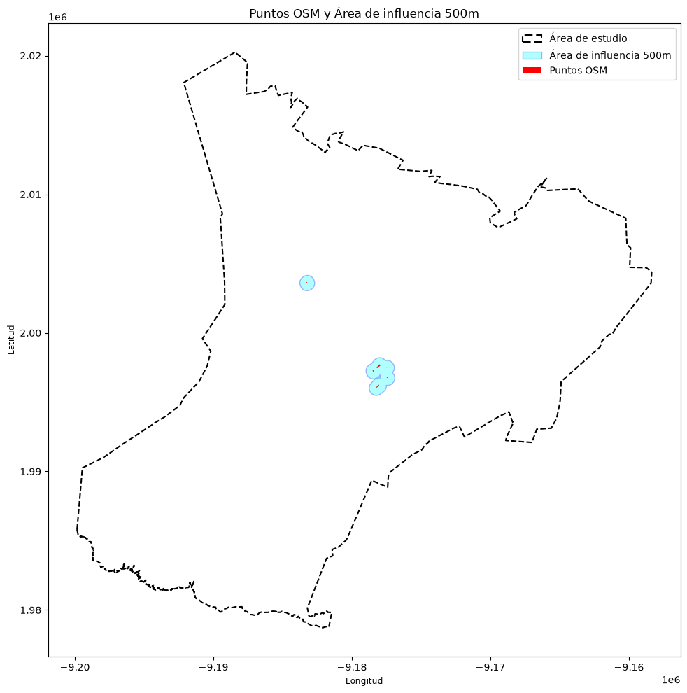

# Análisis de brechas de servicios

Análisis geoespacial para estimar cómo la cantidad de población que se encuentra a una distancia de hasta 500 m de las escuelas registradas en OpenStreetMap.

Este flujo de trabajo combina datos censales por manzana (INEGI), superficie construida satelital (GHSL) y equipamiento educativo (OpenStreetMaps) para construir una primera medida de proximidad entre población y servicios. El área de estudio se controla con una clave municipal de cinco dígitos; el valor inicial del notebook es `07009` que corresponde al municipio de Arriaga, Chiapas.

## Objetivo

Explorar una pregunta de planificación territorial: **¿cuánta población está potencialmente cubierta por escuelas cercanas y dónde se concentra la población fuera de esa proximidad?**

El análisis genera una distribución raster de población y la cruza con buffers de 500 m alrededor de escuelas. El resultado es una estimación de proximidad, no una medición de capacidad escolar, calidad del servicio, rutas peatonales ni tiempos reales de viaje.

## Visualización



La figura muestra la distribución estimada de población y las escuelas identificadas en OpenStreetMap con sus áreas de proximidad de 500 m. La escala de color se limita al percentil 99.9 para facilitar la lectura visual; los datos raster originales no se modifican.

## Flujo de trabajo

1. Carga la población municipal y la población por manzana de INEGI.
2. Descarga y procesa tiles de GHSL Built-Up Surface para el área de estudio.
3. Distribuye la población urbana de cada manzana entre píxeles según la superficie construida.
4. Estima una distribución para la población restante usando la superficie construida fuera de las manzanas.
5. Combina ambas distribuciones en un raster de población.
6. Consulta escuelas de OpenStreetMap, genera buffers de 500 m y estima la población dentro de ellos mediante estadísticas zonales.

## Herramientas

Python, Jupyter, GeoPandas, Rasterio, Rioxarray, OSMnx, Rasterstats, NumPy, Pandas y Matplotlib.

El proyecto muestra un flujo de análisis con datos vectoriales y raster, reproyección de sistemas de coordenadas, descarga de datos geoespaciales, análisis de proximidad y visualización cartográfica.

## Datos

Fuentes utilizadas:

- **INEGI / SCINCE:** población municipal y población por manzana.
- **GHSL:** capa Built-Up Surface para ponderar la distribución espacial de población.
- **OpenStreetMap:** escuelas etiquetadas como `amenity=school`.

Los archivos de `data/` están excluidos del repositorio mediante `.gitignore`, por lo que no se incluyen al clonar el proyecto. Antes de ejecutar el notebook, coloca los insumos locales en estas rutas:

```text
data/input/
├── ghsl/       # Malla de tiles GHSL y tiles descargados por el notebook
├── manzanas/   # CVEMUN_<clave_municipal>.gpkg
└── scince/     # municipal.shp y archivos auxiliares del shapefile
```

El notebook puede descargar los tiles GHSL que intersectan el municipio y consulta OpenStreetMap en línea. Para ello se requiere conexión a Internet. La malla GHSL y los datos censales deben estar disponibles localmente.

## Instalación y ejecución

Se recomienda Python 3.11. Desde la carpeta raíz del proyecto, en PowerShell:

```powershell
py -3.11 -m venv .venv
.\.venv\Scripts\Activate.ps1
python -m pip install --upgrade pip
pip install -r requirements.txt
jupyter lab notebooks/code.ipynb
```

Abre y ejecuta las celdas del notebook en orden, ya que algunas dependen de variables creadas en celdas anteriores. Para analizar otro municipio, cambia `study_area` y asegúrate de contar con el GeoPackage de manzanas correspondiente (`CVEMUN_<clave>.gpkg`) y los datos municipales de INEGI.

## Resultados

Los productos se escriben en `data/output/` y también están excluidos del repositorio:

- `urban_population_distribution_<clave>.tif`: distribución estimada de población urbana.
- `rural_population_distribution_<clave>.tif`: distribución estimada de la población restante.
- `population_distribution_<clave>.tif`: raster combinado de población.
- `osm_features_<clave>.gpkg`: escuelas consultadas en OpenStreetMap.
- `osm_buffers_<clave>.gpkg`: área de cobertura de 500 m alrededor de las escuelas.

El notebook también imprime una estimación de población dentro de los buffers y genera mapas de los rasters y las áreas de proximidad.

## Limitaciones

- La cobertura se define por distancia euclidiana de 500 m; no considera barreras, red vial ni tiempos de traslado.
- La presencia de una escuela en OpenStreetMap no informa su capacidad, nivel educativo, operación o calidad de servicio.
- La asignación raster de población es una estimación ponderada por superficie construida y depende de la calidad y resolución de los insumos.
- Los resultados corresponden al municipio configurado en `study_area` y a las versiones de datos disponibles durante la ejecución.

